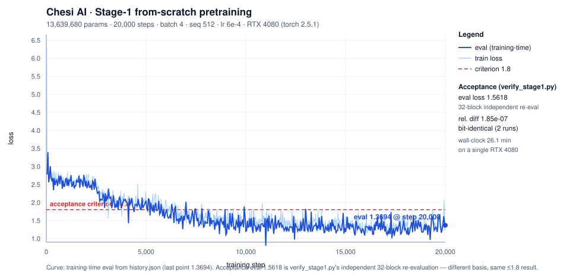

# Chesi AI（澈思）

**A Chinese-personality multimodal small model, trained from scratch.**
Own tokenizer · Own base model · Apache-2.0

> A one-person public experiment: no external model as the base, no model-generated
> training data. Code, corpus admission criteria and training logs are all open.

---

## What this is

Chesi (澈思) is a **Chinese-personality** multimodal small model. Unlike the common
"LoRA on top of an open base model" approach, Chesi's base model is **pretrained from
scratch**: own tokenizer, own architecture, own trainer, own corpus admission rules.

The reason is simple: **the provenance of a personality core has to be clean.** If the base
carries someone else's priors, or if the personality data was generated by another model,
then "whose model is this?" can never be answered honestly. We chose the slower road.

## Stage-1: trained and verified (measured 2026-10-23)

One complete full run of the first tier (13.6M-parameter scale), measured numbers:/n/n> ℹ️ This tier trains on **English reasoning corpora** (OpenThoughts3 + SmallThoughts, see below).
> The Chinese base corpus belongs to Stage-2.

| Metric | Measured | Basis / criterion |
|---|---|---|
| Unique parameters | **13,639,680** | 6 layers / d=384 / 8 heads / seq 512, tied head |
| Training steps | **20,000** | batch 4 · seq 512 · lr 6e-4 |
| Wall-clock | **26.1 minutes** | single RTX 4080, 13 steps/s |
| **eval loss** | **1.5618** | criterion < 1.8 — **first time it actually passed** |
| Numerical consistency | relative diff **1.85e-07** | vs an independent hand-written reference implementation (naive attention / LN / GELU / CE), threshold 15% |
| Reproducibility | **bit-identical** | two runs with the same seed, step-by-step losses bitwise equal |
| Convergence trend | **2.6436 → 1.3732** (−48.1%) | only 2 upward moves across 14 windows — inside the convergence noise floor |



> **Figure note (two different bases — don't mix them)**: the curve shows the **training-time**
> eval (last point **1.3694** @ step 20,000), while the acceptance eval **1.5618** in the table
> above is `verify_stage1.py`'s **independent 32-block held-out re-evaluation**.
> Different bases, and **both satisfy ≤1.8**. Plot script: `scripts/plot_stage1_curve.py`
> (zero dependencies, standard library only, fully reproducible).

> **Honest note**: the strict "no window may increase" criterion rose by 0.16% on the full
> run (inside the convergence noise floor), so we keep a **trend-based** criterion alongside it
> and report both, rather than hiding the miss. See `stage1/README.md` §4.

**Training corpus (Stage-1)**: OpenThoughts 1,200,000 rows + SmallThoughts 102,000 rows.
⚠️ Both are **English reasoning corpora**. In Chesi's roadmap they serve as a *reasoning
capability component* only — not the Chinese base-model staple. The Chinese base corpus comes
from SkyPile-150B (head tier, 61GB / 39 shards already landed); admission criteria below.

**Tokenizer**: self-trained v1.1, character-level, two tiers — Stage-1 vocab 7,276 /
full 11,387, with 100% round-trip consistency across four datasets.

**Device-agnostic**: detection chain `cuda → npu → xpu → musa → cpu`; CPU and CUDA curves differ
by <0.4% at batch size 4 (measured).
⚠️ **Ascend 910B / C500 / BI-V100 have NOT been measured yet** — the device chain is ready; actual
verification happens during the OpenI three-stage smoke run.

## Roadmap

| Stage | Goal | Status |
|---|---|---|
| Stage-1 | 10M-scale from-scratch pretraining: verify convergence and numerical correctness | ✅ verified (table above) |
| Stage-2 | **Chesi-1B** from-scratch pretraining (Chinese base corpus) | 🔄 corpus **downloaded** (SkyPile-150B head tier, 61GB / 39 shards); token stats + admission audit in progress |
| Stage-3 | own base + own personality SFT (target 500k; candidate pool 806k, ratio + filtering not frozen) | ⏳ |
| Stage-4 | DPO / RL: context-aware honesty policy | ⏳ |
| Stage-5 | multimodal: image generation + anti-face-mimicry + no-AI-slop | ⏳ |

**Three hard metrics** (measurable, not slogans):
1. **Prompt-free autonomous seven-step reasoning** — **Goal**: train the seven-step reasoning
   structure *into the weights*, so inference no longer needs a prompt template.
   Path: STaR self-distillation from our own model (generate → filter by answer correctness →
   retrain; our own model is the teacher, so the distillation ban is not violated).
   **Status**: the inference engine is still prompt-injection based (level≥2 prepends the seven
   headings); internalisation starts once Stage-2 (1B) is running.
2. **No AI slop** — real-photo gold standards + preference-pair DPO + blind-test KPI
3. **Anti-face-mimicry** — cross-seed ArcFace cosine with a measurable ceiling; the same prompt must never yield the same face

## Quick start (reproduce Stage-1)

Full walkthrough: **[`docs/REPRODUCE.md`](docs/REPRODUCE.md)** — corpus acquisition + license check,
parquet→jsonl conversion, acceptance criteria, and an honest boundary between *what is guaranteed
to reproduce* and *what shifts when the corpus differs*.

```bash
# deps: torch (CUDA or CPU); everything else is Python standard library
python stage1/train.py --corpus <your corpus path> --steps 20000 --device cuda

# four-criterion verification (②③④ are hard criteria; ① is judged on full runs)
python stage1/verify_stage1.py --mode full
```

Device-agnostic: it runs on CPU too (`--device cpu`), just slower.

## Corpus admission principles (we hold ourselves to these)

- **Base corpus**: only commercially-licensed open human corpora; every source registered
  with its license and tier (License Ledger)
- **Distillation ban**: no training data generated by external models; external models are
  reference points for evaluation only
- **SFT / personality / seven-step chains**: always human-written or self-produced by our
  own model via STaR
- **Honest reporting**: every number carries its basis (sample size / time / source);
  anything not measured is explicitly labelled "not measured"

## Layout

```
Chesi-AI/
├── tokenizer/               # self-trained tokenizer v1.1 (char-level, 7,276 / 11,387, zero deps)
├── docs/                    # reproduction guide + Stage-1 loss curve (SVG, reproducible script)
├── scripts/                 # plotting script (stdlib only) + sync tool
├── stage1/                  # from-scratch pretraining trainer (device-agnostic + DDP + resumable)
│   ├── model.py             # ChesiGPT: 6 layers / d=384 / 8 heads / seq 512
│   ├── data.py              # PackedCorpus: streaming fixed-length blocks
│   ├── train.py             # training loop (cuda→npu→xpu→musa→cpu)
│   ├── verify_stage1.py     # four-criterion verification vs a naive reference implementation
│   └── README.md            # full criteria and experiment log
├── LICENSE                  # Apache-2.0
└── .github/FUNDING.yml      # sponsorship entry points
```

## Sponsorship

This project has no company, no team and no investors — just one person's time and one GPU.
Sponsorship goes directly into **compute credits** (OpenI community, budget for the Chesi-1B
pretraining run) and **corpus curation & evaluation**.

| Channel | Where |
|---|---|
| RMB | 爱发电 / Afdian (`_AFDIAN_URL_`) |
| USD | Ko-fi (`https://ko-fi.com/chesiai`) |

Training progress and loss curves are posted on the sponsorship page every month.

## License

Code and weights: **Apache-2.0** (see `LICENSE`). Third-party dependencies and corpora keep
their own licenses, registered item by item in `docs/`.

## Thanks

- every sponsor — your name goes into the README's Special Thanks list
- the OpenI community — domestic compute and credit support
- everyone who opens an issue, sends a PR, or reports a bug

---

*If this direction matters to you: star it, open an issue, or sponsor it.*
